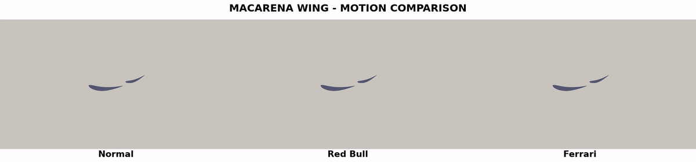
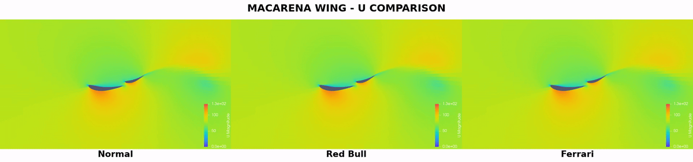
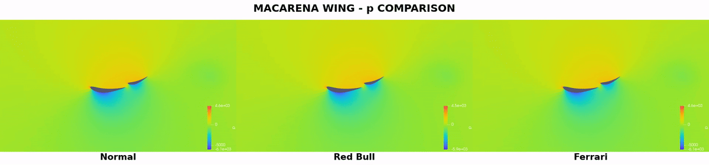
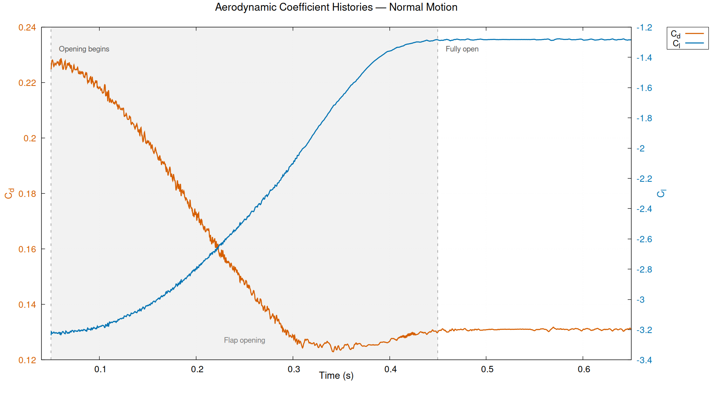
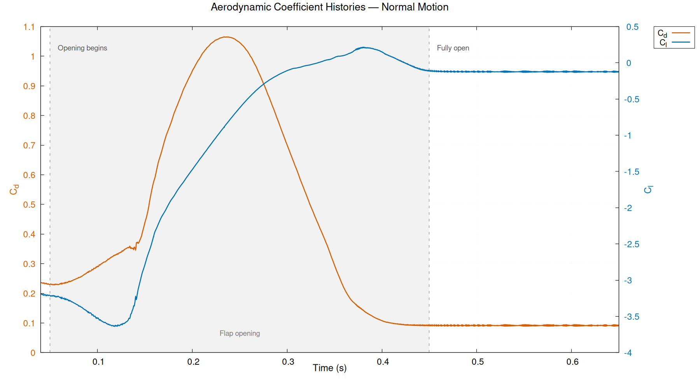
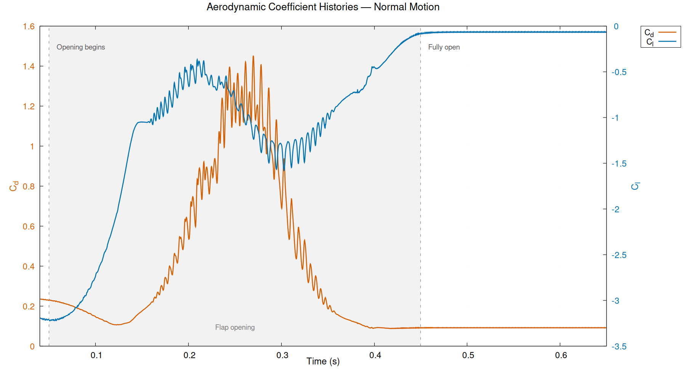

# Dynamic Aerodynamic Analysis of Active Rear-Wing Motions  
I set up three OpenFOAM cases, processed aerodynamic data, and created flow visualisations to compare three different prescribed rear wing flap motions, all using the same E423-based wing section geometry.
The three motion strategies investigated are:  
* **Conventional DRS-inspired motion:** prescribed flap rotation of **−20°**  
* **Red Bull-inspired motion:** prescribed flap rotation of **+160°**  
* **Ferrari-inspired motion:** prescribed flap rotation of **−200°**  
In this repository, I included the numerical setup and processed results I used to compare the transient aerodynamic response of these three motion strategies under identical simulation conditions. I wanted to make sure that any differences I observed came only from the motion profiles themselves.  
**Naming clarification:** The terms 'Conventional DRS-inspired', 'Red Bull-inspired', and 'Ferrari-inspired' are used only as research labels to describe the different motion concepts studied. 'Inspired' does not mean the simulations recreate actual F1 geometry, actuator systems, control laws, or team-measured kinematics. The rotation angles and motion profiles are simple numerical inputs for comparative CFD work. There is no suggestion of affiliation or endorsement.  
  
## Research Overview  
In this study, I wanted to understand how different prescribed flap rotation strategies affect the transient aerodynamic behaviour of an active rear wing section. I was especially interested in seeing how each approach would influence the flow and forces over time.  
All three production cases use the same:  
* E423-based main-wing and flap geometry  
* computational domain  
* circular non-conformal mesh interface  
* mesh-generation procedure  
* boundary conditions  
* turbulence model  
* numerical schemes  
* solver controls  
* aerodynamic force definitions  
* freestream conditions  
* simulation duration  
The principal controlled variable is the prescribed flap-motion profile contained in:  
```
constant/dynamicMeshDict
```
I designed the production cases to isolate the effect of the flap motion strategy, making sure to keep all other aspects of the numerical setup the same. Although it was sometimes challenging to control every variable, I wanted to be confident that any changes in the results were due to the motion strategy alone.  
Processed results are provided for:  
* flap motion  
* velocity magnitude  
* pressure field  
* drag coefficient  
* lift coefficient  
* moment coefficient  
* synchronized visual comparison between the three motion strategies  
  
## Case Matrix  

| Case | Prescribed Rotation | Motion Interval | Simulation End Time |
| ------------------------- | ------------------- | --------------- | ------------------- |
| Conventional DRS-inspired | −20° | 0.050–0.450 s | 0.650 s |
| Red Bull-inspired | +160° | 0.050–0.450 s | 0.650 s |
| Ferrari-inspired | −200° | 0.050–0.450 s | 0.650 s |
  
For each motion, I chose to use a smooth angular velocity profile rather than an instantaneous rotation. I found that this approach better reflects realistic actuation and helps avoid introducing numerical artifacts.  
The general motion sequence is:  
```
0.000–0.050 s   Initial stationary period
0.050–0.450 s   Prescribed flap motion
0.450–0.650 s   Final stationary period
```
I created the different total rotation angles by adjusting the time-dependent angular velocity profiles, while keeping the motion interval the same for each case. This way, I could focus on how the angle and motion profile affected the results.  
  
## Modelling Assumptions and Comparison Basis  
In this study, I focused on a controlled numerical comparison rather than trying to fully reconstruct an F1 rear wing. I recognize that this approach has its limitations, but it allowed me to concentrate on the specific effects of the flap motion strategies.  
### Common 400 ms Motion Interval  
The **2026 FIA Formula 1 Technical Regulations (Article C3.11.6(d)) stipulate that** the rear wing adjuster system must have a maximum transition time of 400ms between its two fixed positions. The transition time is the time taken from the moment the FIA Standard ECU issues the command to the moment the rear wing position sensor confirms that the commanded position has been reached.  
I used 400 ms as the common time reference for all three prescribed motions. For each case, the flap starts moving at 0.050 s and reaches its final position at 0.450 s, so the motion duration is always 0.400 s. I wanted to ensure a fair comparison by keeping this interval consistent.  
By using the same transition interval, I made sure that any differences in the transient aerodynamic response were not caused by different motion durations. Instead, the cases only differ in rotation direction, total rotational displacement, and the time-dependent angular velocity profile.  
**Scope of this assumption:** The 400 ms value is used to match the FIA transition time limit for comparison purposes. This does not mean **that the large angle Red Bull or Ferrari style motions are FIA compliant**. The rotation angles, geometry, actuation, and kinematics for these motions are only conceptual research inputs.  
Official reference: [FIA 2026 Formula 1 Regulations – Section C (Technical), Issue 20](https://www.fia.com/system/files/documents/fia_2026_f1_regulations_-_section_c_technical_-_iss_20_-_2026-08-05.pdf), Article C3.11.6(d)  
### Additional Modelling Assumptions  
* I treated the main wing and flap as rigid aerodynamic surfaces in my simulations. Although this is a simplification, it helped me focus on the aerodynamic effects of the motion strategies.  
* I prescribed the flap motion kinematically, without solving for actuator dynamics, structural deformation, backlash, or control system response. I recognize that this limits the realism of the model, but it allowed me to isolate the aerodynamic effects more clearly.  
* For all three cases, I used the same E423 wing section geometry, freestream conditions, turbulence model, numerical setup, and total simulation time. This consistency was important to me so I could compare the results fairly.  
* In these simulations, I compared a single wing section rather than the full aerodynamics of an F1 car. While this is a limitation, I wanted to focus on the specific effects of the flap motion strategies.  
* Team-inspired labels are used only to identify the conceptual motion strategies and do not represent any reproduction of proprietary hardware or data.  
## Results  
I’ve stored the processed results from all three completed production simulations in the following location:  
```
results/
```
In the repository, I included both the results for each individual case and the synchronised comparisons across all three cases.  
  
### Motion Comparison  
I wanted to compare the prescribed flap motion for all three configurations, so I created the animation below using the same visualisation window and time sequence for each.  
<p align="center">  
   
</p>  
**Full-resolution version:**  
[Macarena Motion Comparison — MP4](results/comparison/Macarena_Motion_Comparison.mp4)
  
### Velocity-Field Comparison  
To directly compare the differences in the transient flow field for the three motion strategies, I used the same post-processing setup to show velocity magnitude.  
<p align="center">  
   
</p>  
**Full-resolution version:**  
[Macarena Velocity Comparison — MP4](results/comparison/Macarena_U_Comparison.mp4)
  
### Pressure-Field Comparison  
I used the same camera framing, time sequence, and visualisation procedure for all three production cases to show the transient OpenFOAM pressure field response.  
<p align="center">  
   
</p>  
**Full-resolution version:**  
[Macarena Pressure Comparison — MP4](results/comparison/Macarena_p_Comparison.mp4)
  
### Aerodynamic Coefficients  
I calculated the aerodynamic force and moment coefficients for both the main wing and the flap patches.  
For each production case, I included the following in the repository:  
* combined drag and lift coefficient history  
* drag coefficient history  
* lift coefficient history  
* moment coefficient history  
* merged force-coefficient dataset  
The merged coefficient datasets I published cover the entire simulation interval up to 0.65 seconds.  
  
#### Conventional DRS-inspired Motion  
<p align="center">  
   
</p>  
Additional results:  
* [Drag coefficient history](results/normal/coefficients/Macarena_Normal_Cd.png)
* [Lift coefficient history](results/normal/coefficients/Macarena_Normal_Cl.png)
* [Moment coefficient history](results/normal/coefficients/Macarena_Normal_Cm.png)
* [Merged force-coefficient dataset](results/normal/coefficients/forceCoeffs_Normal.dat)
  
#### Red Bull-inspired Motion  
<p align="center">  
   
</p>  
Additional results:  
* [Drag coefficient history](results/redbull/coefficients/Macarena_RedBull_Cd.png)
* [Lift coefficient history](results/redbull/coefficients/Macarena_RedBull_Cl.png)
* [Moment coefficient history](results/redbull/coefficients/Macarena_RedBull_Cm.png)
* [Merged force-coefficient dataset](results/redbull/coefficients/forceCoeffs_RedBull.dat)
  
#### Ferrari-inspired Motion  
<p align="center">  
   
</p>  
Additional results:  
* [Drag coefficient history](results/ferrari/coefficients/Macarena_Ferrari_Cd.png)  
* [Lift coefficient history](results/ferrari/coefficients/Macarena_Ferrari_Cl.png)  
* [Moment coefficient history](results/ferrari/coefficients/Macarena_Ferrari_Cm.png)
* [Merged force-coefficient dataset](results/ferrari/coefficients/forceCoeffs_Ferrari.dat)
  
### Individual Flow Visualizations  
I made individual animations available in both GIF and MP4 format.  
I chose GIFs for immediate viewing in the browser, while the MP4s provide higher resolution animation output.  

#### Conventional DRS-inspired Motion

| Quantity | GIF | MP4 |
|---|---|---|
| Motion | [View GIF](results/normal/Macarena_Normal_Motion.gif) | [View MP4](results/normal/Macarena_Normal_Motion.mp4) |
| Velocity | [View GIF](results/normal/Macarena_Normal_U.gif) | [View MP4](results/normal/Macarena_Normal_U.mp4) |
| Pressure | [View GIF](results/normal/Macarena_Normal_p.gif) | [View MP4](results/normal/Macarena_Normal_p.mp4) |

#### Red Bull-inspired Motion

| Quantity | GIF | MP4 |
|---|---|---|
| Motion | [View GIF](results/redbull/Macarena_RedBull_Motion.gif) | [View MP4](results/redbull/Macarena_RedBull_Motion.mp4) |
| Velocity | [View GIF](results/redbull/Macarena_RedBull_U.gif) | [View MP4](results/redbull/Macarena_RedBull_U.mp4) |
| Pressure | [View GIF](results/redbull/Macarena_RedBull_p.gif) | [View MP4](results/redbull/Macarena_RedBull_p.mp4) |

#### Ferrari-inspired Motion

| Quantity | GIF | MP4 |
|---|---|---|
| Motion | [View GIF](results/ferrari/Macarena_Ferrari_Motion.gif) | [View MP4](results/ferrari/Macarena_Ferrari_Motion.mp4) |
| Velocity | [View GIF](results/ferrari/Macarena_Ferrari_U.gif) | [View MP4](results/ferrari/Macarena_Ferrari_U.mp4) |
| Pressure | [View GIF](results/ferrari/Macarena_Ferrari_p.gif) | [View MP4](results/ferrari/Macarena_Ferrari_p.mp4) |
  
## Numerical Setup  
### Solver  
* **OpenFOAM Foundation v13**  
* Solver: incompressibleFluid  
* transient incompressible simulation  
  
### Flow Conditions  
* Freestream velocity: **80 m/s**  
* Kinematic viscosity: **1.486 × 10⁻⁵ m²/s**  
* Reference density for aerodynamic coefficients: **1.225 kg/m³**  
  
### Turbulence Modelling  
For the production simulations, I used a Reynolds-averaged turbulence formulation:  
* **RANS**  
* **k-ω SST**  
The turbulence configuration is defined in:  
```
constant/momentumTransport
```
### Near-Wall Treatment and y+ 
I used wall-function treatment together with the k-ω SST RANS turbulence model. The average wall (y^+) values at the final simulation time, **t = 0.65 s**, are:  

| Case                      | mainWing Average (y^+) | flap Average (y^+) |
| ------------------------- | ---------------------- | ------------------ |
| Conventional DRS-inspired | 43.40                  | 46.99              |
| Red Bull-inspired         | 46.69                  | 59.25              |
| Ferrari-inspired          | 58.14                  | 59.82              |
  
For all three production cases, I kept the mesh, freestream velocity, fluid properties, and turbulence model the same. I decided to use a wall function RANS treatment instead of the wall-resolved y+ approximately 1 SST.  
  
### Reference Quantities  
For aerodynamic coefficients, I used the following reference values:  
* Reference chord, lRef: **0.20 m**  
* Reference area, Aref: **0.004 m²**  
* Freestream reference velocity, magUInf: **80 m/s**  
* Reference density, rhoInf: **1.225 kg/m³**  
I evaluated aerodynamic stresses over the following surfaces:  
```
mainWing
flap
```
  
## Moving-Mesh Method  
I put the movable flap into a dedicated rotating cell zone.
I prescribed the motion using OpenFOAM's `motionSolver` → `solidBody` → `rotatingMotion` framework.

I set the rotation origin at the flap hinge.
To separate the rotating near field from the stationary surrounding mesh, I've used a circular non-conformal interface.
I've defined the angular velocity as a time-dependent table in `constant/dynamicMeshDict`. The total flap rotation corresponding to each angular velocity profile is obtained by integrating over the prescribed motion interval.
The moving mesh setup is identical for all three production cases. The only difference between them is the prescribed motion which I've altered for each case.

## Repository Structure

```text
.
├── README.md
│
├── cases/
│   ├── Normal_DRS/
│   │   ├── 0/
│   │   ├── constant/
│   │   │   └── triSurface/
│   │   └── system/
│   │
│   ├── RedBull_160deg/
│   │   ├── 0/
│   │   ├── constant/
│   │   │   └── triSurface/
│   │   └── system/
│   │
│   └── Ferrari_200deg/
│       ├── 0/
│       ├── constant/
│       │   └── triSurface/
│       └── system/
│
├── scripts/
│   └── postProcessing/
│       └── plot_force_coefficients.gnuplot
│
└── results/
    ├── comparison/
    │   ├── Macarena_Motion_Comparison.gif
    │   ├── Macarena_Motion_Comparison.mp4
    │   ├── Macarena_U_Comparison.gif
    │   ├── Macarena_U_Comparison.mp4
    │   ├── Macarena_p_Comparison.gif
    │   └── Macarena_p_Comparison.mp4
    │
    ├── normal/
    │   ├── Macarena_Normal_Motion.gif
    │   ├── Macarena_Normal_Motion.mp4
    │   ├── Macarena_Normal_U.gif
    │   ├── Macarena_Normal_U.mp4
    │   ├── Macarena_Normal_p.gif
    │   ├── Macarena_Normal_p.mp4
    │   └── coefficients/
    │       ├── Macarena_Normal_Cd.png
    │       ├── Macarena_Normal_Cd_Cl.png
    │       ├── Macarena_Normal_Cl.png
    │       ├── Macarena_Normal_Cm.png
    │       └── forceCoeffs_Normal.dat
    │
    ├── redbull/
    │   ├── Macarena_RedBull_Motion.gif
    │   ├── Macarena_RedBull_Motion.mp4
    │   ├── Macarena_RedBull_U.gif
    │   ├── Macarena_RedBull_U.mp4
    │   ├── Macarena_RedBull_p.gif
    │   ├── Macarena_RedBull_p.mp4
    │   └── coefficients/
    │       ├── Macarena_RedBull_Cd.png
    │       ├── Macarena_RedBull_Cd_Cl.png
    │       ├── Macarena_RedBull_Cl.png
    │       ├── Macarena_RedBull_Cm.png
    │       └── forceCoeffs_RedBull.dat
    │
    └── ferrari/
        ├── Macarena_Ferrari_Motion.gif
        ├── Macarena_Ferrari_Motion.mp4
        ├── Macarena_Ferrari_U.gif
        ├── Macarena_Ferrari_U.mp4
        ├── Macarena_Ferrari_p.gif
        ├── Macarena_Ferrari_p.mp4
        └── coefficients/
            ├── Macarena_Ferrari_Cd.png
            ├── Macarena_Ferrari_Cd_Cl.png
            ├── Macarena_Ferrari_Cl.png
            ├── Macarena_Ferrari_Cm.png
            └── forceCoeffs_Ferrari.dat
```

## Case Contents

I've included the standard OpenFOAM config directories in each of the production cases as I wanted anyone who wanted to have a go at reproducing exactly what I did to be able to. I know how important it is to be able to walk through someone else's process, so I've tried to make that as easy as possible.

### `0/`

Initial and boundary-condition fields:

* U
* p
* k
* omega
* nut

### `constant/`

Physical properties, turbulence configuration, geometry, and moving-mesh definitions:

* physicalProperties
* momentumTransport
* dynamicMeshDict
* triSurface/mainWing.stl
* triSurface/flap.stl

### `system/`

Mesh generation, solver control, numerical schemes, parallel decomposition, and post-processing definitions:

* blockMeshDict
* snappyHexMeshDict
* createBafflesDict
* meshQualityDict
* controlDict
* fvSchemes
* fvSolution
* decomposeParDict
* functions
  
## Post-Processing  
I used ParaView and ParaFoam for flow visualisation because I wanted to clearly see what was happening in the simulation and to really understand the flow formations.   
For the synchronized comparison animations, all three production cases were post-processed using consistent:  
* camera position  
* field representation  
* image framing  
* time synchronization  
* animation duration  
By keeping the visualization settings the same, I was able to directly compare the motion, velocity, and pressure fields between the three cases. This approach made it much easier for me to spot the differences and understand how each setup affected the results.  
  
### Aerodynamic Coefficient Processing  
While running the simulation, I noticed that OpenFOAM saved the aerodynamic coefficient data in segmented forceCoeffs.dat output directories. At first, this made it a bit challenging for me to look at the results, since I had to figure out how to bring all the segments together.  
Initially, I wasn't quite sure how to plot the aerodynamic coefficients smoothly. After some trial and error, I realized that I needed to join the segments together to get smooth time histories. Figuring this out was a small puzzle, but I enjoyed working through it.  
The common Gnuplot script used to generate the aerodynamic coefficient figures is included at:  
```
scripts/postProcessing/plot_force_coefficients.gnuplot
```
The script supports:  
* drag coefficient, Cd  
* lift coefficient, Cl  
* moment coefficient, Cm  
* combined Cd and Cl dual-axis plots  
* automatic merging of segmented OpenFOAM forceCoeffs.dat output  
* plotting directly from the merged datasets published in this repository  
The published coefficient datasets are located at:  
```
results/normal/coefficients/forceCoeffs_Normal.dat
results/redbull/coefficients/forceCoeffs_RedBull.dat
results/ferrari/coefficients/forceCoeffs_Ferrari.dat
```
  
### Media Processing  
I wanted the processed visualisation files to be easy for anyone to access, so I provided them in both GIF and MP4 formats. My goal was to make it simple for people to view the results, no matter what device or platform they were using.  
I chose GIFs because they can be viewed directly in the browser on GitHub, while the MP4s offer higher resolution for anyone who wants to see more detail. I wanted to give people both quick access and the option for a closer look.  
To generate the GIFs and create the comparison video, I used FFmpeg.  
  
## Reproducibility  
I set up the three production case directories in exactly the same way, except for the prescribed motion profile. I was deliberate about this because I wanted to make sure that any differences in the results came only from the motion profiles. I took extra care to keep everything else consistent.  
I didn't store the generated mesh files in the repository. Although they are important, they are quite large. Instead, the repository provides the:  
* mesh-generation dictionaries  
* surface geometry  
* boundary conditions  
* physical properties  
* turbulence configuration  
* numerical settings  
* aerodynamic force definitions  
* moving-mesh definitions  
required to reconstruct the numerical cases.  
At this stage, I haven't produced an automated Allrun script yet. I'm still working on verifying the full workflow from a clean case directory, and I want to make sure everything works smoothly before I share it.  
The aerodynamic coefficient post-processing workflow is separately reproducible using:  
```
scripts/postProcessing/plot_force_coefficients.gnuplot
```
The published results/ directory contains selected processed outputs derived from the completed production simulations, including:  
* aerodynamic coefficient histories  
* merged force-coefficient datasets  
* processed PNG figures  
* GIF animations  
* MP4 visualizations  
* synchronized three-case comparisons  
  
### What Is Not Included  
Initially I thought about including the massive solver outputs and the intermediate working files in the repo, but I realised that would make it a lot harder to maintain and share and I thought it was more important to keep the repo clean and focused on the key results.  
This includes:  
* processor*/  
* reconstructed transient time directories  
* constant/polyMesh/  
* raw transient field data  
* complete raw OpenFOAM postProcessing/ directories  
* intermediate ParaView state files  
* intermediate animation frame sequences  
* temporary validation cases  
* development backups  
* incomplete or superseded production runs  
Selected processed results are instead included separately under:  
```
results/
```
I wanted to make sure the processed outputs did a good job of capturing the key aerodynamic and visualisation results, whilst still keeping the repo reasonably manageable. Given that the full transient CFD field solution is probably not something most people would need, I've opted to focus on the key results.  
  
## Development and OpenFOAM Tutorial Lineage  
Case development started from the standard workflows and examples that were part of the **OpenFOAM Foundation v13**.  
In particular, the solid-body rotating-mesh framework used in:  
```
constant/dynamicMeshDict
```
was adapted from the official OpenFOAM mixerVessel2D tutorial and subsequently modified for:  
* the E423-based wing geometry  
* the project-specific flap hinge location  
* the circular non-conformal interface  
* prescribed time-dependent angular velocity  
* conventional and large-angle flap rotations  
* aerodynamic coefficient evaluation  
* the numerical and mesh requirements of the present study  
The official wingMotion tutorial suite was also used as a reference during the development and assessment of the moving mesh approaches.  
  
## Research Status  
I've run all three of the production cases in this repository through the full transient simulation sequence all the way up to 0.65 seconds. 
Processed results are provided under results/, including:  
* flap-motion animations  
* velocity-field animations  
* pressure-field animations  
* aerodynamic coefficient histories  
* merged force-coefficient datasets  
* synchronized visual comparisons between the three motion strategies  
I didn't include the full transient OpenFOAM field data as it would take an absolutely massive amount of storage. Some people might find that useful but I thought it was far more sensible to just look at the processed data.  
Instead, I made sure the repository preserves:  
1. the numerical case definitions required to document and reconstruct the simulation setup; and  
2. a compact set of the processed numerical and visual results to enable comparison of the three motion strategies.  
  
## Interpretation of Results  
I designed the three cases to provide a fairly controlled numerical comparison of the various prescribed flap motion strategies.
When I look at the differences between the simulations I interpret them in the light of the modelling assumptions that I've used in this study (the ones listed above for example).  
* wing-section representation  
* prescribed flap kinematics  
* RANS turbulence modelling  
* incompressible flow formulation  
* finite computational domain  
* finite spatial resolution  
* finite temporal resolution  
I created the Red Bull and Ferrari inspired cases as conceptual motion analogues for the research comparison. I've focused on the motion in each case rather than trying to reproduce the detail.    
I look at these results as a comparative CFD study of various prescribed motion strategies rather than as a reconstruction or a performance claim in relation to any one particular proprietary F1 aerodynamic system.  
  
## Software  
The numerical cases were developed for:  
```
OpenFOAM Foundation v13
```
Post-processing and visualization used:  
* ParaView / ParaFoam  
* Gnuplot  
* FFmpeg  
* standard Linux command-line tools  
  
## License and Attribution  
OpenFOAM case structures and any workflow components which have been adapted are still subject to the relevant OpenFOAM licensing terms.  
Project specific case modifications, processed data, figures, animations and documentation should all be used with appropriate attribution.  
Users redistributing material derived from OpenFOAM must ensure that the appropriate OpenFOAM licensing and attribution requirements are satisfied.  
  
## Citation  
If this repository is being used as a reference for any other project, report or derivative simulation then please cite the repository and be very clear about the numerical configuration that has been used in this repository as opposed to any configuration that may have been modified independently, including:
* geometry  
* mesh  
* motion profile  
* turbulence model  
* numerical scheme  
* solver configuration  
* boundary condition  
* post-processing procedure  
